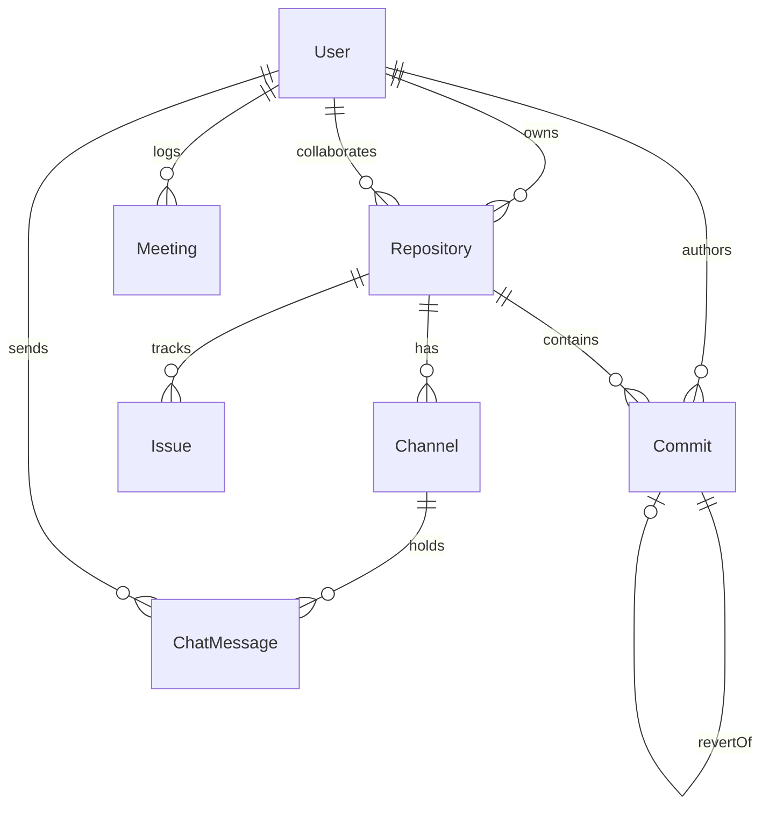
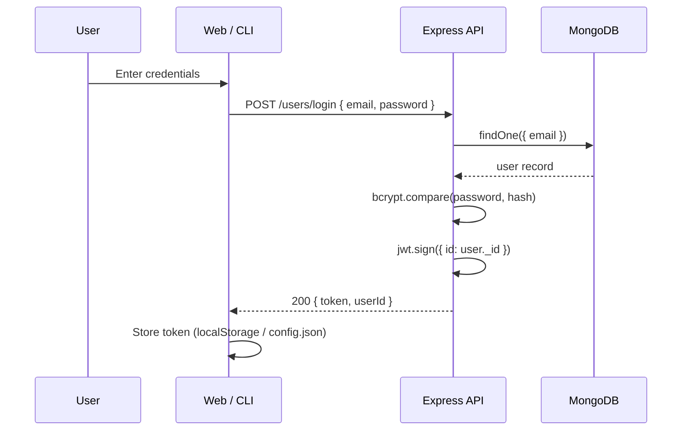
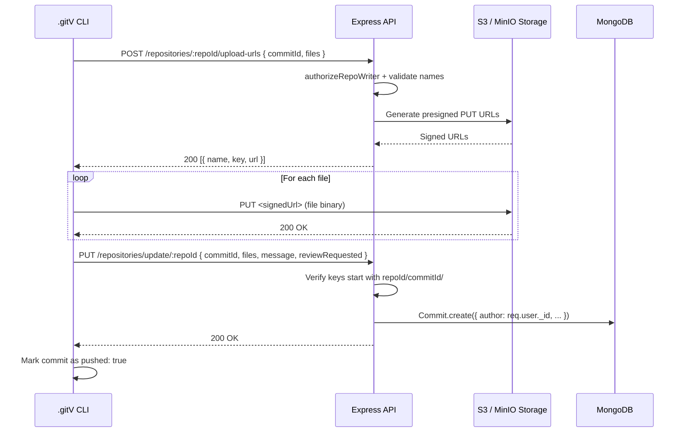
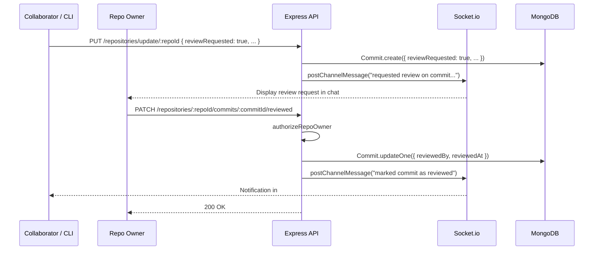
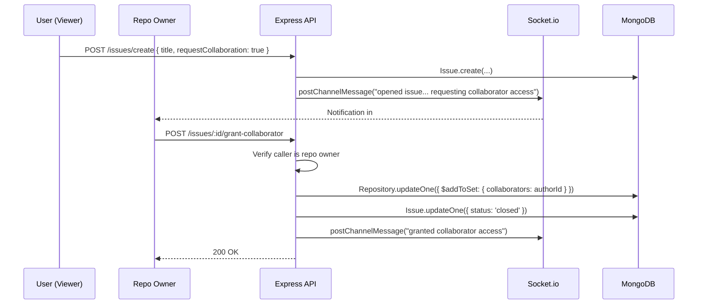

# GitVerse System Architecture & Flow Guide

> Note on legacy code: `meridian-import/` contains legacy standalone meeting prototype code; video meetings are natively integrated in `frontend/src/features/meeting/`.

---

## A. System Map

```mermaid
graph TD
    CLI[".gitV CLI (Node / yargs)"] -->|HTTP REST + Bearer JWT| SVR["Express 5 + Socket.io 4 Server"]
    WEB["React 19 SPA (Vite)"] -->|HTTP REST + Bearer JWT| SVR
    WEB <-->|WebSocket Signaling & Chat| SVR
    SVR <-->|Mongoose 9 / MongoClient| DB[("MongoDB (GitVerse DB)")]
    SVR -->|AWS SDK v2 (Sign URLs)| S3[("S3 / MinIO Storage")]
    CLI -->|Direct PUT/GET via Signed URLs| S3
```

- **React 19 SPA** (`frontend/`, port 5173): Client interface talking to REST endpoints via Axios and live features via Socket.io.
- **Express 5 + Socket.io 4** (`backend/server.js`, port 3000): Unified HTTP server hosting API routers, handshake auth, and WebRTC/channel rooms.
- **MongoDB**: Primary document store for users, repositories, commits, issues, channels, and chat records.
- **S3 / MinIO**: Object storage. Credentials stay server-side; clients upload/download directly using 5-minute pre-signed URLs.
- **.gitV CLI** (`backend/index.js`): Developer CLI operating from project folders with Bearer JWT auth and no AWS credentials.

---

## B. Folder & File Map

### Backend
- `backend/server.js`: Express & Socket.io server boot, Mongo connection, proxy trust, socket auth handshake.
- `backend/index.js`: CLI entry point using yargs to route commands (`init`, `add`, `commit`, `push`, `pull`, `revert`, `login`, `log`, `whoami`, `launch`).
- `backend/routes/main.router.js`: Root router mounting user, repo, issue, and activity sub-routers.
- `backend/routes/user.routes.js`: Public & authenticated user endpoints (`/signup`, `/login`, profile CRUD).
- `backend/routes/repo.router.js`: Repository lifecycle, signed URLs, commit history, review, and revert routes.
- `backend/routes/issue.router.js`: Issue CRUD and owner collaboration approval (`/:id/grant-collaborator`).
- `backend/routes/chat.router.js`: Text channel discovery (`/repos/:repoId/channels`) and historical message pagination.
- `backend/routes/meeting.router.js`: Meeting history logging and caller identity verification.
- `backend/routes/activity.router.js`: Aggregated heatmap activity counts for user contributions.
- `backend/controllers/repoControllers.js`: Repository logic, S3 URL signing, review stamp, revert diffing, and collaborator management.
- `backend/controllers/userControllers.js`: MongoDB native client queries for user registration, bcrypt auth, and profiles.
- `backend/controllers/issueControllers.js`: Issue creation, collaboration requests, and automated `#collab-requests` notifications.
- `backend/controllers/chatControllers.js`: Auto-creates `#general` & `#collab-requests` channels and fetches message history.
- `backend/controllers/meetingControllers.js`: Saves and retrieves call session history in `Meeting`.
- `backend/controllers/activityController.js`: Aggregates repository, issue, and commit timestamps for profile activity graphs.
- `backend/models/userModel.js`: Mongoose schema for user accounts, repositories, and follow links.
- `backend/models/repoModel.js`: Mongoose schema for repos, owner ref, visibility, and collaborators array.
- `backend/models/commitModel.js`: Mongoose schema for commits with S3 keys, review flags, and revert references.
- `backend/models/issueModel.js`: Mongoose schema for repo issues and collaborator request flags.
- `backend/models/channelModel.js`: Mongoose schema for text channels scoped by repo.
- `backend/models/chatMessageModel.js`: Mongoose schema for persistent chat messages with sender and channel refs.
- `backend/models/meetingModel.js`: Mongoose schema tracking meeting codes and caller user IDs.
- `backend/middlewares/authMiddleware.js`: Verifies `Authorization: Bearer <token>` JWT and attaches `req.user`.
- `backend/middlewares/authorizeMiddleware.js`: Guards routes for repo owners (`authorizeRepoOwner`) and writers (`authorizeRepoWriter`).
- `backend/utils/repoAccess.js`: Central access check returning `{ repo, role, isOwner, isCollaborator, canPush }`.
- `backend/utils/chatHelpers.js`: Server-side helper to ensure channels exist and post messages into Socket rooms.
- `backend/sockets/channels.js`: Socket handlers for channel join, leave, rate limiting, and real-time message broadcasting.
- `backend/sockets/meeting.js`: Socket handlers for WebRTC mesh signaling (`signal`, `join-call`, `media-status`).
- `backend/config/aws-config.js`: Server-only AWS S3 client configuration.

### CLI Controllers
- `backend/controllers/apiConfig.js`: Sourced API base URL from `GITV_API_URL` or `http://127.0.0.1:3000`.
- `backend/controllers/gitvConfig.js`: Reads local `.gitV/config.json` and verifies stored auth token.
- `backend/controllers/init.js`: Initializes `.gitV/` folder structure and links `repoId`.
- `backend/controllers/add.js`: Stages local files into `.gitV/staging/`.
- `backend/controllers/commit.js`: Writes `.gitV/commits/<uuid>/` metadata with optional `--review` flag.
- `backend/controllers/push.js`: Obtains presigned S3 PUT URLs, uploads staged files, and registers remote commit.
- `backend/controllers/pull.js`: Queries remote commits, downloads files via presigned GET URLs, and purges `removedFiles`.
- `backend/controllers/revert.js`: Local-only offline commit history rollback.
- `backend/controllers/login.js`: Authenticates against `/users/login` and writes token to `.gitV/config.json`.
- `backend/controllers/log.js`: Prints local commit logs with optional `--oneline` or `-n`.
- `backend/controllers/whoami.js`: Inspects linked repository and JWT expiration.

### Frontend
- `frontend/src/main.jsx`: Boots React root with `BrowserRouter` and `AuthProvider`.
- `frontend/src/Routes.jsx`: App routes guarded by `RequireAuth` (`/dashboard`, `/repositories/:repoId`, `/meet/:url`).
- `frontend/src/authContext.jsx`: Provides authentication context, storing `userId` and `token` in `localStorage`.
- `frontend/src/api/client.js`: Axios instance with request auth injection and 401 redirect interceptor.
- `frontend/src/api/repositories.js`: Repository HTTP client methods with visibility normalization.
- `frontend/src/components/repo/RepositoryDetails.jsx`: Main repo container tabbed between files and real-time chat.
- `frontend/src/components/repo/RepoFiles.jsx`: File browser displaying files and code preview.
- `frontend/src/components/repo/CommitHistory.jsx`: Lists commits chronologically with author details.
- `frontend/src/components/repo/RepoChat.jsx`: Real-time text chat panel with channel selection and messaging.
- `frontend/src/features/meeting/VideoMeet.jsx`: WebRTC multi-peer video conferencing room with media controls.

---

## C. Data Models



- **User** (`backend/models/userModel.js`): `username` (String, unique), `email` (String, unique), `password` (String, hashed), `repositories` ([ObjectId->Repository]), `followedUsers` ([ObjectId->User]), `starredRepositories` ([ObjectId->Repository]).
- **Repository** (`backend/models/repoModel.js`): `name` (String, unique), `description` (String), `content` (String), `visibility` (Boolean, default: true), `isStarred` (Boolean, default: false), `owner` (ObjectId->User), `issues` ([ObjectId->Issue]), `collaborators` ([ObjectId->User]).
- **Commit** (`backend/models/commitModel.js`): `author` (ObjectId->User), `message` (String), `repository` (ObjectId->Repository), `files` ([String] S3 keys), `reviewRequested` (Boolean, default: false), `reviewedBy` (ObjectId->User), `reviewedAt` (Date), `removedFiles` ([String]), `revertOf` (ObjectId->Commit).
- **Issue** (`backend/models/issueModel.js`): `title` (String), `description` (String), `status` ("open"|"closed"), `repository` (ObjectId->Repository), `author` (ObjectId->User), `requestCollaboration` (Boolean, default: false).
- **Channel** (`backend/models/channelModel.js`): `repo` (ObjectId->Repository), `name` (String, lowercase), `createdBy` (ObjectId->User). Compound index on `{ repo, name }`.
- **ChatMessage** (`backend/models/chatMessageModel.js`): `channel` (ObjectId->Channel), `sender` (ObjectId->User), `text` (String, max 2000), `replyTo` (ObjectId->ChatMessage). Index on `{ channel, createdAt: -1 }`.
- **Meeting** (`backend/models/meetingModel.js`): `meetingCode` (String), `user` (ObjectId->User), `date` (Date, default: Date.now).

---

## D. Access Model

Access resolution is centered in `backend/utils/repoAccess.js` (`getRepoAccess(repoId, user)`):
1. Returns `null` if user is unauthenticated, `repoId` is invalid, repository doesn't exist, or repo is private (`visibility === false`) and user is neither owner nor collaborator.
2. Resolves `role`: `"owner"` if `user._id === repo.owner`; `"collaborator"` if in `repo.collaborators`; otherwise `"viewer"`.
3. `canPush`: true for `"owner"` and `"collaborator"`.

### Route Guards
- `authMiddleware`: Requires valid Bearer JWT. Rejects with 401.
- `authorizeRepoOwner`: Verifies `req.user._id === repo.owner`. Rejects with 403.
- `authorizeRepoWriter`: Calls `getRepoAccess`; requires `access.canPush === true`. Rejects with 403.

### Role vs. Action Matrix
| Action | Owner | Collaborator | Viewer (Public) | Non-Member (Private) |
|---|---|---|---|---|
| View Repo & Commits | Allowed | Allowed | Allowed | Denied (404/403) |
| Read Channel Chat | Allowed | Allowed | Allowed | Denied |
| Post Channel Message | Allowed | Allowed | Allowed | Denied |
| Join Video Call (`repo-<id>`) | Allowed | Allowed | Allowed | Denied (`join-denied`) |
| Push Commits (`upload-urls`) | Allowed | Allowed | Denied (403) | Denied (404/403) |
| Mark Commit Reviewed | Allowed | Denied (403) | Denied (403) | Denied (403) |
| Web Revert Commit | Allowed | Denied (403) | Denied (403) | Denied (403) |
| Manage Collaborators | Allowed | Denied (403) | Denied (403) | Denied (403) |
| Approve Collaboration Issue | Allowed | Denied (403) | Denied (403) | Denied (403) |

---

## E. API Route Table

| Method | Path | Middleware | Controller Function | File |
|---|---|---|---|---|
| POST | `/users/signup` | None | `signUp` | `backend/routes/user.routes.js` |
| POST | `/users/login` | None | `login` | `backend/routes/user.routes.js` |
| GET | `/users/` | None | `getAllUsers` | `backend/routes/user.routes.js` |
| GET | `/users/userProfile/:id` | None | `getUser` | `backend/routes/user.routes.js` |
| PUT | `/users/updateProfile/:id` | None | `updateUser` | `backend/routes/user.routes.js` |
| DELETE| `/users/deleteUser/:id` | None | `deleteUser` | `backend/routes/user.routes.js` |
| POST | `/repositories/create` | `authMiddleware` | `createRepository` | `backend/routes/repo.router.js` |
| GET | `/repositories/all` | `authMiddleware` | `getAllRepositories` | `backend/routes/repo.router.js` |
| GET | `/repositories/:repoId` | `authMiddleware` | `getRepositoryById` | `backend/routes/repo.router.js` |
| GET | `/repositories/name/:repoName` | None | `getRepositoryByName` | `backend/routes/repo.router.js` |
| GET | `/repositories/owner/:repoOwner`| None | `getRepositoryByOwner` | `backend/routes/repo.router.js` |
| GET | `/repositories/user/:currUserId`| None | `getRepositoriesForCurrUser` | `backend/routes/repo.router.js` |
| PUT | `/repositories/update/:repoId` | `authMiddleware`, `authorizeRepoWriter` | `updateRepository` | `backend/routes/repo.router.js` |
| PATCH| `/repositories/toggle-visibility/:repoId` | `authMiddleware`, `authorizeRepoOwner` | `visibilityToggle` | `backend/routes/repo.router.js` |
| PATCH| `/repositories/toggle-star/:repoId` | `authMiddleware` | `starToggle` | `backend/routes/repo.router.js` |
| DELETE| `/repositories/delete/:repoId` | `authMiddleware`, `authorizeRepoOwner` | `deleteRepository` | `backend/routes/repo.router.js` |
| GET | `/repositories/:repoId/file` | `authMiddleware` | `getRepoFile` | `backend/routes/repo.router.js` |
| GET | `/repositories/:repoId/commits`| `authMiddleware` | `getRepoCommits` | `backend/routes/repo.router.js` |
| POST | `/repositories/:repoId/upload-urls` | `authMiddleware`, `authorizeRepoWriter` | `getUploadUrls` | `backend/routes/repo.router.js` |
| POST | `/repositories/:repoId/download-urls` | `authMiddleware` | `getDownloadUrls` | `backend/routes/repo.router.js` |
| PATCH| `/repositories/:repoId/commits/:commitId/reviewed` | `authMiddleware`, `authorizeRepoOwner` | `markCommitReviewed` | `backend/routes/repo.router.js` |
| POST | `/repositories/:repoId/commits/:commitId/revert` | `authMiddleware`, `authorizeRepoOwner` | `revertCommit` | `backend/routes/repo.router.js` |
| GET | `/repositories/:repoId/collaborators` | `authMiddleware`, `authorizeRepoOwner` | `listCollaborators` | `backend/routes/repo.router.js` |
| POST | `/repositories/:repoId/collaborators` | `authMiddleware`, `authorizeRepoOwner` | `addCollaborator` | `backend/routes/repo.router.js` |
| DELETE| `/repositories/:repoId/collaborators/:username` | `authMiddleware`, `authorizeRepoOwner` | `removeCollaborator` | `backend/routes/repo.router.js` |
| POST | `/issues/create` | `authMiddleware` (via router) | `createIssue` | `backend/routes/issue.router.js` |
| GET | `/issues/repo/:id` | `authMiddleware` (via router) | `getAllIssues` | `backend/routes/issue.router.js` |
| GET | `/issues/:id` | `authMiddleware` (via router) | `getIssueById` | `backend/routes/issue.router.js` |
| PUT | `/issues/update/:id` | `authMiddleware` (via router) | `updateIssueById` | `backend/routes/issue.router.js` |
| DELETE| `/issues/delete/:id` | `authMiddleware` (via router) | `deleteIssueById` | `backend/routes/issue.router.js` |
| POST | `/issues/:id/grant-collaborator` | `authMiddleware` (via router) | `grantCollaborator` | `backend/routes/issue.router.js` |
| GET | `/chat/repos/:repoId/channels` | `authMiddleware` (via router) | `listChannels` | `backend/routes/chat.router.js` |
| POST | `/chat/repos/:repoId/channels` | `authMiddleware` (via router) | `createChannel` | `backend/routes/chat.router.js` |
| GET | `/chat/channels/:channelId/messages` | `authMiddleware` (via router) | `getMessages` | `backend/routes/chat.router.js` |
| GET | `/meetings/history` | `authMiddleware` | `getHistory` | `backend/routes/meeting.router.js` |
| POST | `/meetings/history` | `authMiddleware` | `addToHistory` | `backend/routes/meeting.router.js` |
| GET | `/meetings/me` | `authMiddleware` | Inline handler | `backend/routes/meeting.router.js` |
| GET | `/activity/:userId` | None | `getUserActivity` | `backend/routes/activity.router.js` |

---

## F. Socket Event Table

The Socket.io server authenticates incoming connections via handshake auth token (`io.use` in `backend/server.js`), assigning `socket.user = user`.

| Event Name | Direction | Handler File | Verification & Access Checks |
|---|---|---|---|
| `join-room` | Client -> Server | `backend/server.js` | Verifies `socket.user._id === userId`. Joins personal room. |
| `channel:join` | Client -> Server | `backend/sockets/channels.js` | Checks `getRepoAccess(channel.repo, socket.user)`. Joins room `channel:<id>`. |
| `channel:leave`| Client -> Server | `backend/sockets/channels.js` | Leaves room `channel:<id>`. |
| `channel:message`| Client -> Server | `backend/sockets/channels.js` | Requires auth, room membership, length (1-2000), rate limit (max 5/3s). |
| `channel:message`| Server -> Client | `backend/sockets/channels.js` | Broadcasts saved message to room `channel:<id>`. |
| `join-call` | Client -> Server | `backend/sockets/meeting.js` | Checks `canJoin(roomId, socket.user)` (repo access if room is `repo-*`). |
| `join-denied` | Server -> Client | `backend/sockets/meeting.js` | Emitted when caller fails `canJoin` authorization. |
| `user-joined` | Server -> Client | `backend/sockets/meeting.js` | Broadcasts new peer socketId and participant media statuses. |
| `signal` | Bidirectional | `backend/sockets/meeting.js` | Forwards WebRTC SDP/ICE payloads to destination `toId`. |
| `media-status`| Client -> Server | `backend/sockets/meeting.js` | Updates in-memory audio/video flags and relays to room participants. |
| `chat-message`| Client -> Server | `backend/sockets/meeting.js` | In-call ephemeral chat. Sender stamped from `socket.user.username`. |
| `chat-message`| Server -> Client | `backend/sockets/meeting.js` | Relays ephemeral call chat message to room participants. |
| `user-left` | Server -> Client | `backend/sockets/meeting.js` | Emitted on socket disconnect to prune video tiles. |

---

## G. End-to-End Flows

### 1. Login and JWT (Web + CLI)
1. User provides email and password via Web form (`frontend/src/components/auth/LogIn.jsx`) or CLI prompt/flags (`backend/controllers/login.js`).
2. Request POSTs to `/users/login` (`backend/controllers/userControllers.js` `login`).
3. Server validates user via `bcrypt.compare` and issues signed token using `jwt.sign({ id: user._id }, JWT_SECRET, { expiresIn: '1h' })`.
4. Web stores `token` and `userId` in `localStorage`; CLI saves them into `.gitV/config.json`.
5. Subsequent requests attach token as `Authorization: Bearer <token>`.



### 2. Load a Repo Page (Role Resolution)
1. Browser routes to `/repositories/:repoId` (`frontend/src/components/repo/RepositoryDetails.jsx`).
2. Hook `useRepository` invokes `getRepository(repoId)` (`frontend/src/api/repositories.js`).
3. Request hits `GET /repositories/:repoId` (`backend/controllers/repoControllers.js` `getRepositoryById`).
4. Controller invokes `getRepoAccess(repoId, req.user)` to verify permissions and compute role (`owner`, `collaborator`, `viewer`).
5. Server responds with repository object augmented with `role`. Frontend sets tabs and permissions.

### 3. CLI init/add/commit(--review)
1. Developer runs `gitv init <repoId>` (`backend/controllers/init.js`); `.gitV/` folder structure and `config.json` are initialized.
2. Developer runs `gitv add <file>` (`backend/controllers/add.js`); file copies into `.gitV/staging/`.
3. Developer runs `gitv commit <message> [--review]` (`backend/controllers/commit.js`).
4. Controller assigns UUIDv4 as `commitHashID`, moves staged files into `.gitV/commits/<commitHashID>/`, and writes `commit.json` containing message, timestamp, and `reviewRequested` flag. Staging is cleared.

### 4. CLI Push with Signed Upload URLs
1. Developer runs `gitv push` (`backend/controllers/push.js` `pushChanges`).
2. Reads `.gitV/commits/` to find unpushed commits; extracts filenames.
3. Sends POST to `/repositories/:repoId/upload-urls` with `{ commitId, files }`.
4. Server validates `authorizeRepoWriter`, checks UUID and filenames, and generates S3 presigned PUT URLs via `s3.getSignedUrlPromise('putObject')`.
5. CLI uploads each file buffer directly to S3 with `axios.put(url, fileContent)`.
6. CLI registers commit by calling `PUT /repositories/update/:repoId` sending `{ commitId, message, files: uploadedKeys, reviewRequested }`.
7. `updateRepository` verifies key prefixes (`<repoId>/<commitId>/`), inserts `Commit` document, updates repo, and posts review request to `#general` if flagged.



### 5. CLI Pull with Signed Download URLs and removedFiles
1. Developer runs `gitv pull` (`backend/controllers/pull.js` `pullChanges`).
2. CLI fetches all remote commits via `GET /repositories/:repoId/commits`.
3. For each missing commit, CLI POSTs file keys to `/repositories/:repoId/download-urls`.
4. Server checks repo access via `getRepoAccess` and signs GET URLs via `s3.getSignedUrlPromise('getObject')`.
5. CLI fetches file buffers via `axios.get(url)` and writes to both `.gitV/commits/<id>/` and the working directory.
6. For every filename in `commit.removedFiles`, CLI deletes the file from the local working directory.
7. CLI records local `commit.json` with `pushed: true`.

### 6. Web Revert (Conflict 409 Rule, Key Reuse)
1. Repo owner triggers revert via `POST /repositories/:repoId/commits/:commitId/revert` (`backend/controllers/repoControllers.js` `revertCommit`).
2. Guard `authorizeRepoOwner` verifies caller owns the repo.
3. Controller retrieves target commit and all repository commits sorted oldest first.
4. Identifies files touched by target commit. Checks if any commit after target touched those same filenames. If yes, returns 409 Conflict with list of conflicting filenames.
5. If clean, for each target file, controller locates latest commit prior to target to reuse its S3 key. Files with no prior commit are added to `removedFiles`.
6. Creates new `Commit` record referencing `revertOf: targetCommit._id`, restored S3 keys, and `removedFiles`. No S3 objects are copied.

### 7. Review Flag and Mark-Reviewed (+ #general Post)
1. Commit created with `--review` is pushed. `updateRepository` detects `reviewRequested: true`.
2. Server calls `postChannelMessage(io, repoId, "general", ...)` announcing `"requested review on commit <shortId>: <message>"`.
3. Repo owner reviews changes and issues `PATCH /repositories/:repoId/commits/:commitId/reviewed` (`backend/controllers/repoControllers.js` `markCommitReviewed`).
4. Guard `authorizeRepoOwner` confirms caller is repo owner.
5. Sets `commit.reviewedBy = req.user._id` and `commit.reviewedAt = new Date()`.
6. Server broadcasts confirmation to `#general`: `"marked commit <shortId> as reviewed"`.



### 8. Add/Remove Collaborator (Incl. Socket Eviction)
1. Owner sends `POST /repositories/:repoId/collaborators` with `{ username }`.
2. Target user is found; repo updated via `$addToSet: { collaborators: targetUser._id }`.
3. When removing (`DELETE /repositories/:repoId/collaborators/:username`):
4. User pulled from `collaborators` via `$pull`.
5. Server retrieves all repository channels from `Channel` model.
6. Iterates each room `channel:<id>` using `io.in(room).fetchSockets()`.
7. Any connected socket matching `socket.user._id === targetUser._id` leaves room immediately (`sock.leave(room)`).

### 9. Issue with requestCollaboration -> #collab-requests Post -> Grant Collaborator
1. User creates issue with `requestCollaboration: true` via `POST /issues/create` (`backend/controllers/issueControllers.js` `createIssue`).
2. Controller saves `Issue` and calls `postChannelMessage` in channel `#collab-requests`.
3. Repo owner reviews request and calls `POST /issues/:id/grant-collaborator` (`grantCollaborator`).
4. Controller checks owner access, adds issue author to `repo.collaborators` via `$addToSet`, marks issue `status = "closed"`, and posts announcement to `#collab-requests`.



### 10. Repo Chat (REST History + Live Socket, Persist-Then-Broadcast)
1. User switches to Chat tab (`frontend/src/components/repo/RepoChat.jsx`).
2. Component loads channels via `GET /chat/repos/:repoId/channels` (`listChannels` auto-creates `general` and `collab-requests` if missing).
3. Client emits `channel:join` with channel ID; server verifies repo access before joining room `channel:<channelId>`.
4. Client fetches initial messages via `GET /chat/channels/:channelId/messages` (`getMessages`).
5. User sends message: client emits `channel:message` (`channelId, text, ack`).
6. Server verifies auth, room membership, and rate limits (max 5 per 3s).
7. Server persists message to `ChatMessage` in DB first, then broadcasts to room via `io.to(room).emit("channel:message", payload)`.

### 11. Start Call and Join (/meet/:url, canJoin, Signaling Events)
1. User clicks video button in repo navigation (`/meet/repo-<repoId>`).
2. Browser mounts `VideoMeet.jsx`, connects socket with handshake token, and emits `join-call` with URL.
3. `sockets/meeting.js` checks `canJoin(roomId, socket.user)`. Because room prefix is `repo-`, calls `getRepoAccess`. If denied, emits `join-denied` and disconnects.
4. If allowed, caller is added to in-memory `connections[roomId]` and server emits `user-joined` with client list.
5. Clients establish WebRTC mesh peers, exchanging SDP offers/answers and ICE candidates via socket `signal` events (`io.to(toId).emit('signal', ...)`).
6. Media mute/unmute states are relayed via `media-status` events.

### 12. Dashboard Repo List
1. User opens `/dashboard` (`frontend/src/components/dashboard/Dashboard.jsx`).
2. Client calls `getRepositoriesForUser(userId)` hitting `GET /repositories/user/:currUserId` (`backend/controllers/repoControllers.js` `getRepositoriesForCurrUser`).
3. Server queries owned repos (`Repository.find({ owner: currUserId })`) and collaborated repos (`Repository.find({ collaborators: currUserId })`).
4. Tags each repo with `role: "owner"` or `role: "collaborator"` and returns unified array.
5. Dashboard renders owned and collaborated repositories in list.

---

## H. "Where Do I Look to Change X"

1. **Add a field to Commit metadata**:
   - Schema: `backend/models/commitModel.js`
   - CLI generation: `backend/controllers/commit.js`
   - Server handler: `backend/controllers/repoControllers.js` (`updateRepository`)
   - History display: `frontend/src/components/repo/CommitHistory.jsx`
2. **Change role access rules**:
   - Access decision logic: `backend/utils/repoAccess.js` (`getRepoAccess`)
   - Route middlewares: `backend/middlewares/authorizeMiddleware.js`
3. **Change S3 upload validation or expiration**:
   - Presigned URL generation & checks: `backend/controllers/repoControllers.js` (`getUploadUrls`)
   - CLI upload behavior: `backend/controllers/push.js`
4. **Add a new CLI command**:
   - Register parser: `backend/index.js`
   - Command controller: `backend/controllers/<command>.js`
5. **Add a new text chat channel type or default**:
   - Defaults initialization: `backend/controllers/chatControllers.js` (`listChannels`)
   - Schema & validation: `backend/models/channelModel.js`
6. **Modify video call signaling or permissions**:
   - Server logic & `canJoin`: `backend/sockets/meeting.js`
   - Client WebRTC mesh: `frontend/src/features/meeting/VideoMeet.jsx`
7. **Change rate limits on APIs or sockets**:
   - REST endpoints: `backend/server.js` (`apiLimiter`)
   - Channel socket rate limits: `backend/sockets/channels.js` (`RATE_LIMIT_MAX`, `RATE_LIMIT_WINDOW_MS`)
8. **Update User authentication & JWT claims**:
   - Token creation & auth: `backend/controllers/userControllers.js` (`login`, `signUp`)
   - JWT verification middleware: `backend/middlewares/authMiddleware.js`
   - Socket handshake auth: `backend/server.js` (`io.use`)
9. **Alter file preview logic or secret detection**:
   - Previewer filters & extensions: `frontend/src/components/repo/RepoFiles.jsx` (`TEXT_EXTENSIONS`, `SECRET_FILE_RE`)
   - File download streaming: `backend/controllers/repoControllers.js` (`getRepoFile`)
10. **Add automated bot channel notifications**:
    - Helper utility: `backend/utils/chatHelpers.js` (`postChannelMessage`)
    - Trigger points: `backend/controllers/issueControllers.js`, `backend/controllers/repoControllers.js`

